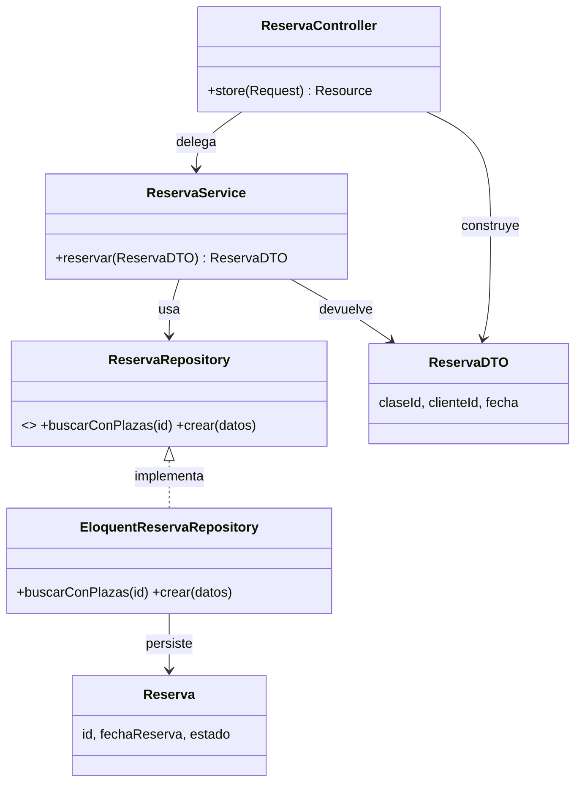
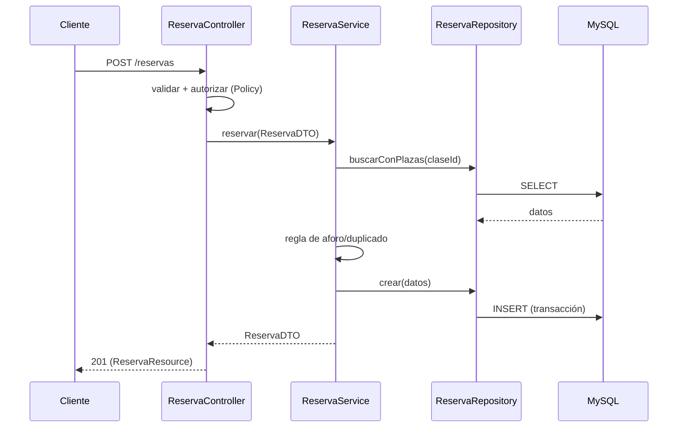

# Diseño del sistema: *STADIO*

## 1. Criterios generales

El diseño toma como referencia **GRASP**, **SOLID** y algunos patrones **GoF**. No se aplicarán patrones por obligación: se prioriza una solución sencilla, testeable y coherente con Laravel. Si una funcionalidad sencilla se resuelve bien con Eloquent, no se añadirán DTO, interfaz y repositorio sin una justificación concreta.

**Decisión de reparto de responsabilidades**: los casos de uso y las reglas de negocio se concentran inicialmente en **servicios** (uno por dominio), y los modelos Eloquent se centran en persistencia y relaciones. Como consecuencia, los diagramas de datos muestran entidades y relaciones, mientras que el comportamiento de los casos de uso se documenta en los servicios.

## 2. Ejemplo aplicado: reservar una clase

En este ejemplo se usan DTO y repositorio:

- **Controller**: valida, autoriza, delega, responde.
- **Service**: regla de negocio.
- **Repository**: acceso a datos.
- **DTO**: transporte entre capas.

## 3. GRASP

| Patrón | Cómo se aplica en STADIO |
|--------|--------------------------|
| **Information Expert** | Las reglas de cada caso de uso se centralizan en el servicio del dominio correspondiente: `ReservaService` aplica las reglas de reserva; `CuotaService`, las de cuotas; `AnalisisService`, las heurísticas. Es una decisión de diseño pragmática, no una aplicación estricta del experto en el modelo. |
| **Creator** | Se usan constructores, métodos de creación o factories cuando la creación requiere configuración. Las factories de Laravel se destinan principalmente a datos de prueba; no se atribuye automáticamente al repositorio la responsabilidad de crear objetos de dominio. |
| **Controller** | Los controladores de `Http/Controllers` reciben el evento del sistema (la petición), validan, autorizan y delegan. |
| **Polymorphism** | Contratos con implementaciones intercambiables cuando hay más de una o se necesitan dobles de prueba: `PaymentGateway`, `Notifier`, `ExerciseCatalog`. |
| **Protected Variations** | Se aíslan los puntos inestables: integraciones tras interfaces, `PaymentGateway` sustituible, import puntual de wger y notificaciones multicanal. |

**Low Coupling, High Cohesion, Pure Fabrication e Indirection** se resuelven con la separación en capas: un servicio por dominio, un controlador por recurso y un repositorio solo donde aporte valor. Servicios, repositorios, DTOs, Jobs y Notifications son clases que no son del dominio que cohesionan y desacoplan, y actúan como intermediarios entre el controlador y los datos o entre el servicio y lo externo.

## 4. SOLID

| Principio | Cómo se aplica |
|-----------|----------------|
| **S** — Single Responsibility | Cada clase mantiene una responsabilidad clara: controller (HTTP), service (caso de uso/negocio), repository si existe (persistencia especializada). |
| **O** — Open/Closed | Con contratos estables, se puede añadir una implementación de `Notifier` o `PaymentGateway` con cambios mínimos en el código cliente. |
| **L** — Liskov Substitution | Las implementaciones se sustituyen sin alterar el contrato: cualquier `PaymentGateway` o `Notifier` cumple su interfaz. |
| **I** — Interface Segregation | Interfaces pequeñas y específicas (`PaymentGateway`, `AccessGateway`, `ExerciseCatalog`) en lugar de una interfaz genérica enorme. |
| **D** — Dependency Inversion | En las integraciones que deban sustituirse, los servicios dependen de contratos y Laravel resuelve las implementaciones mediante el contenedor de servicios. No hace falta crear interfaces para todas las clases. |

## 5. Patrones GoF

| Patrón | Dónde | Para qué |
|--------|-------|----------|
| **Repository** | Repositorios concretos donde haya consultas complejas o reutilizadas | Encapsular esas consultas; no crear uno automáticamente por cada modelo. |
| **Strategy** | Implementaciones intercambiables de `Notifier` o `PaymentGateway`, si el diseño las necesita | Elegir proveedor o estrategia mediante un contrato común. |
| **Adapter** | `StripeAdapter`, `NfcAccessGateway`, `WgerClient` | Adaptar SDK/API externas a las interfaces internas. |
| **Command** | `Jobs/` (`SendQuotaReminder`, `ImportExercises`) | Encapsular operaciones asíncronas (colas). |
| **Observer** | Eventos/*listeners* de Laravel | Reaccionar a hechos (p. ej. cuota pagada → notificar). |
| **Chain of Responsibility** | *Middleware* de Laravel | Cadena de auth → permisos → perfil docente. |
| **Factory** | Factories de Laravel y de DTOs | Crear objetos complejos sin acoplar. |

